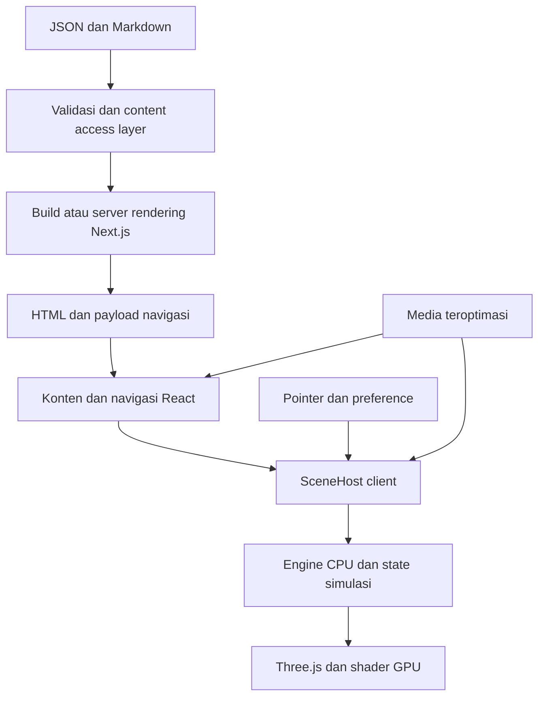

# PRD — Portofolio Personal Interaktif

**Versi:** 1.14 · **Tanggal:** 24 Oktober 2026 · **Status:** revisi komposisi ke satu workbench kompak/fokus objek per halaman disepakati melalui koreksi pemilik (§7.7). Runtime empat meja sebelumnya masih baseline yang harus dikonsolidasikan. Transisi/fallback dan pemeriksaan produksi tersedia; penerimaan visual serta QA perangkat nyata masih terbuka. Hasil terbaru: [QA About/Experience](QA-STORY-CORNERS.md); QA motion sebelumnya historis; QA robotics sebelumnya historis; QA kamera sebelumnya historis, [TODO](../TODO.md) dan [manifest aset](ASSETS.md). Sudut lain tetap lanjutan. Kode/QA Robotics dipertahankan sebagai riwayat; rencana §16.5 bukan integrasi database.

**Pemilik produk:** Abdiel Deandra EL Dzaky. **Referensi pengalaman:** [clarissabuilds.com](https://www.clarissabuilds.com/). **Dasar penelitian:** [report REA](../analysis/REPORT.md), [arsitektur](../analysis/architecture.md), [jaringan](../analysis/network.md). **Bahasa dokumen:** Indonesia.

Dokumen ini menetapkan produk yang akan dibangun, alasan setiap fitur, perilaku yang diharapkan, struktur konten, rancangan sistem, cara pengujian, dan batas rilis. Detail teknis merupakan rancangan implementasi awal yang boleh berubah selama kebutuhan produk dan kriteria penerimaan tetap terpenuhi. Semua angka performa, target, dan estimasi di sini adalah usulan produk baru, bukan hasil pengukuran website referensi.

**Panduan membaca:** bagian 1–6 menjelaskan produk dan profil; 7–11 membahas desain, opsi twist dan scope; 12–15 merinci fitur dan data; 16–18 menjelaskan backend serta engine; 19–24 menetapkan kualitas dan pengujian; 25–30 berisi tahapan, risiko, keputusan terbuka, template dan sumber.

## 1. Ringkasan produk

Website portofolio personal yang mempertahankan karakter desain referensi: gelap, tenang, kolom teks editorial yang ringkas, navigasi sederhana, serta latar interaktif yang terasa hidup. Portofolio harus menunjukkan karya dan cara berpikir pemilik, sambil memudahkan perekrut, calon kolaborator, dan pengunjung lain memahami kontribusinya.

Pemilik adalah mahasiswa Teknik Komputer Universitas Indonesia dengan pengalaman sebagai asisten lab di Digital Laboratory, staff software EXERCISE FTUI 2026, dan Badan Pengurus Kominfo IME FTUI 2026. Bidang karyanya mencakup robotics, programming, web development, video editing, dan desain menggunakan Figma. Situs perlu menampung kedalaman teknis sekaligus kemampuan komunikasi visual, tanpa menjadikan semuanya daftar kemampuan yang setara tanpa konteks.

Janji produk: **pengunjung dapat memahami siapa pemiliknya, melihat bukti karya yang relevan, dan menemukan cara menghubunginya; pengalaman visual membuat identitas tersebut lebih mudah diingat.**

Rilis pertama berupa situs publik dengan konten terstruktur dalam repository, tanpa login pengunjung atau database wajib. CMS dapat ditambahkan ketika cara kerja pengelolaan konten membutuhkannya. Visualisasi berjalan di browser; konten tetap terbaca saat WebGL atau JavaScript tidak tersedia.

## 2. Fakta, asumsi, dan keputusan

### 2.1 Fakta dari pemilik

| Fakta yang sudah diberikan | Implikasi produk |
| --- | --- |
| Nama: Abdiel Deandra EL Dzaky | Nama lengkap digunakan pada identitas; nama panggilan tetap boleh ditentukan pemilik |
| Mahasiswa Teknik Komputer, Universitas Indonesia | Menjadi jangkar identitas pada About dan metadata profil |
| Asisten lab di Digital Laboratory | Ditampilkan dalam pengalaman; uraian tugas dan periode detail perlu diisi pemilik |
| Staff software EXERCISE FTUI 2026 | Ditampilkan sebagai pengalaman organisasi dengan karya/kontribusi yang dapat ditautkan |
| Badan Pengurus Kominfo IME FTUI 2026 | Menunjukkan pengalaman komunikasi/organisasi; jabatan publik mengikuti ejaan yang disetujui pemilik |
| Pengalaman robotics, programming, webdev, editing video, Figma dan lainnya | Sistem project harus mendukung karya teknis dan kreatif serta format bukti yang berbeda |
| Tujuan memamerkan karya, termasuk untuk kerja dan magang | Projects, kontribusi individual, CV, dan kontak perlu mudah ditemukan |
| Sangat menyukai desain referensi; twist tetap ingin punya opsi | Struktur visual dipertahankan; konsep personal dipilih dari alternatif yang terdefinisi |
| Pernah menyukai arah Digital Observatory dengan nuansa laboratorium digital | Baseline sebelum jeda; kini dapat dikaji dalam brainstorming personal (§2.4), belum ada pengganti yang dipilih |
| Baris minat mengetik/menghapus; permintaan ASCII sebelumnya dibatalkan 24 Oktober | Typing menjaga layout, pause dan reduced motion. Inspect ASCII tidak ada pada aplikasi aktif; studi lama disimpan |
| Menyebut digital, robotics dan AI enthusiast; photography sebagai kandidat frasa | Minat dapat muncul pada intro; kurasi frasa akhir tidak otomatis menjadi klaim profesi |

Nama panggilan, foto, angkatan, periode jabatan, tugas rinci, teknologi yang dikuasai, prestasi, ketersediaan kerja, minat pribadi di luar bidang di atas, dan metrik hasil belum diberikan. Jangan mengarang atau menerbitkan placeholder untuk informasi tersebut.

### 2.2 Fakta dari referensi

Referensi terbukti memakai Next.js App Router, React, Three.js/WebGL2, GLSL, Tailwind, dan sebagian Canvas 2D. Konten HTML dilapis di atas scene. Route About, Projects, Writing, dan Cabinet mempunyai pengalaman visual yang berbeda. Ada drag orbit, reset kamera, dan hide/show text.

Empat nama objek pada homepage adalah anotasi, sedangkan brightness/time merupakan sumbu grafik. Toggle objek dan slider pada prototype lokal adalah penambahan kita. Sumber konten server, CMS, database, dan strategi rendering setiap route pada referensi tidak sepenuhnya diketahui. Kebutuhan website baru tidak bergantung pada penebakan backend tersebut.

### 2.3 Keputusan awal yang diusulkan

| Keputusan | Default PRD | Status |
| --- | --- | --- |
| Identitas utama | Mahasiswa Teknik Komputer yang berkarya pada sistem, software, dan komunikasi visual | Berdasarkan profil; copy akhir perlu dipilih |
| Struktur | Home, About, Projects, Experience, Writing, Cabinet; kontak/CV bila tersedia | Home proof aktif; sudut/route terpisah mengikuti review §7.7 |
| Twist visual | Lab/workbench elektronik personal dengan material/cahaya hangat | Konsep §2.5; Home sudah diimplementasikan, menunggu review visual |
| Pengelolaan konten | JSON + Markdown/MDX lokal tepercaya, validasi saat build | Writing mendukung komponen interaktif bila diperlukan |
| Database/admin | Supabase opsional untuk data/media/admin | Belum diwajibkan; writing file-based tidak memerlukan database |
| Bahasa publik | Inggris untuk perekrutan dan narasi perjalanan | Disepakati pemilik §2.5 |
| Tingkat personalisasi | Konten sepenuhnya milik pemilik; visual berangkat dari referensi | Prinsip tetap |
| Analytics | Opsional; tidak menahan rilis | Mengikuti preferensi pemilik dan kebutuhan pengukuran |

### 2.4 Keputusan terbaru: jeda dan brainstorming ulang konsep personal

Pada 23 Oktober 2026 pemilik meminta pekerjaan berhenti sementara, semua informasi diperbarui, dan berencana brainstorming di chat baru. Ada kemungkinan besar beberapa konsep berubah supaya portofolio lebih menyatu dengan kepribadiannya. Belum ada konsep pengganti, pilihan objek baru atau persetujuan final terhadap kandidat Robotics study.

Bagian visual/positioning/rekomendasi setelah bagian ini merekam arah sebelumnya: Digital Observatory, laboratorium digital, Clarissa Builds dan robotics. Semuanya menjadi bahan yang dapat dikaji ulang; tidak otomatis dibatalkan dan tidak boleh dipaksakan sebagai konsep akhir. Fakta identitas/pengalaman, kejujuran konten, aksesibilitas dan pemisahan konten/scene tetap berlaku. Preferensi spesifik yang berubah ditetapkan melalui instruksi pemilik berikutnya.

Kode, aset/lisensi, prototype dan bukti penelitian dipertahankan. Tidak ada implementasi baru, penggantian aset atau deployment selama jeda. Brainstorming berikutnya dimulai dari karakter pribadi, cerita/minat yang ingin ditonjolkan, tujuan pengunjung dan suasana yang terasa cocok. Hasilnya perlu merumuskan konsep, hierarki konten dan preferensi lama yang dipertahankan/diubah sebelum memilih efek/library. Setelah keputusan tersedia dan pemilik meminta eksekusi, perbarui dokumen lalu gunakan kembali fondasi yang relevan.

Handoff, fakta profil, pemeriksaan terakhir, batas QA, backlog dan perintah menjalankan kembali dirangkum pada checkpoint teratas [TODO](../TODO.md). Tidak ada build/browser baru pada pembaruan dokumentasi jeda ini.

### 2.5 Hasil brainstorming: lab/workbench personal

**Keputusan pemilik, 23 Oktober 2026:** arah baru adalah lab/workspace elektronik 3D dengan bentuk sederhana seperti [Hamza](https://www.raomuhammadhamza.tech/), material dan pencahayaan hangat, serta komposisi/editorial tenang seperti Clarissa. Foto 2 paling disukai; perpaduan komposisi foto 3, kehangatan foto 2, aktivitas foto 4 dan kepadatan rak foto 1 disetujui sebagai arahan. Foto adalah referensi suasana, bukan bukti ruangan/aset milik pemilik.

- Prioritas pengunjung: perekrut; tujuan tindakan: menghubungi pemilik. Narasi yang ingin disampaikan adalah perjalanan pemilik, tanpa menetapkan tiga atribut kepribadian yang belum dipilih.
- Bahasa utama Inggris. Intro mengarah ke `Hi, I'm Abdiel.` dan typing frasa minat di bawah; copy final belum dikurasi. Status mahasiswa harus tepat; `a computer engineering student` kandidat yang jujur.
- Home membuka pandangan workbench dengan intro di tengah. About, Projects, Experience, Writing dan Cabinet mempunyai sudut masing-masing dalam lab yang sama. Robot pada meja Projects merupakan kandidat visual, bukan otomatis bukti karya pemilik.
- Kandidat benda: kabel dan mechanical keyboard; manga serta stiker meme tentatif. Benda/penempatan akhir belum diputuskan.
- Interaksi scene terutama observasi/inspeksi. Tidak ada komitmen membuat game, simulasi alat atau robot yang diprogram pengunjung. Writing boleh memuat penjelasan interaktif jika relevan.
- Karya dan detail pengalaman diisi kemudian; konten belum siap tetap draft. Writing bebas topik, termasuk fisika/pembelajaran, dengan Markdown/MDX sebagai rencana authoring. Pemilik meminta perencanaan database; penyedia, admin dan workflow editor belum dipilih (§16.5).

Keputusan ini menggantikan pernyataan belum ada konsep pengganti di §2.3/§2.4 dan rekomendasi historis di §8. Kode/aset/lisensi lama dipertahankan. Persetujuan konsep belum merupakan permintaan eksekusi; jangan mengubah scene, memasang database atau memulai server sampai diminta.

## 3. Masalah dan peluang

Portofolio yang hanya berupa daftar skill sulit menjelaskan kualitas kontribusi. Portofolio yang sangat visual tetapi menghalangi informasi juga menyulitkan perekrut. Pada profil multidisiplin, risiko tambahan adalah pengunjung menganggap pemilik mengerjakan banyak hal tanpa fokus.

Produk harus menjawab tiga pertanyaan berurutan: **siapa orang ini, apa bukti kemampuannya, dan mengapa saya perlu menghubunginya?** Latar interaktif berfungsi sebagai ciri identitas dan demonstrasi craft. Penjelasan karya, peran, keputusan, dan hasil tetap menjadi bukti utama.

Peluangnya adalah menghubungkan pengalaman Teknik Komputer dan Digital Laboratory dengan software, robotics, desain, serta video melalui satu cerita: pemilik membangun sistem dan menyampaikan ide dalam bentuk yang dapat digunakan orang lain.

## 4. Tujuan, batas, dan indikator keberhasilan

### 4.1 Tujuan

- Menampilkan identitas dalam lima detik pertama tanpa mengharuskan pengunjung memainkan scene.
- Menyediakan bukti karya yang dapat dipilih sesuai kebutuhan teknis atau kreatif.
- Menjelaskan kontribusi individual pada project tim dan organisasi.
- Membuat CV, kontak, dan tautan profesional dapat diakses dalam maksimal dua tindakan dari halaman utama.
- Menjaga pengalaman membaca, aksesibilitas, dan performa di perangkat mobile.
- Memungkinkan pemilik menambah konten tanpa mengubah komponen tampilan.
- Menyediakan satu pengalaman visual yang khas dan konsisten dengan identitas pemilik.

### 4.2 Bukan tujuan rilis pertama

Situs tidak mencakup jejaring sosial, login pengunjung, e-commerce, komentar publik, dashbogkftrard analitik buatan sendiri, chatbot, simulator fisika ilmiah terkalibrasi, multiplayer, sistem lamaran, editor video dalam browser, ataupun empat scene 3D kompleks yang wajib selesai bersamaan. Dunia 3D yang harus dijelajahi untuk membuka konten juga di luar scope.

### 4.3 Target produk dan metode pengukuran

| Indikator | Target awal | Cara memeriksa |
| --- | --- | --- |
| Kejelasan identitas | Minimal 4 dari 5 penguji dapat menyebut bidang utama dan tujuan situs dalam 5 detik | Uji singkat tanpa penjelasan sebelumnya |
| Menemukan karya | Minimal 4 dari 5 penguji menemukan satu project sesuai minat dalam 30 detik | Tugas pencarian terarah |
| Kejelasan kontribusi | Minimal 4 dari 5 penguji dapat membedakan peran pemilik dari peran tim | Baca satu case study lalu tanyakan kontribusi |
| Menemukan kontak/CV | Maksimal 2 tindakan dari About dan Projects | Uji alur manual |
| Perubahan konten | Penambahan satu project dari template tidak memerlukan perubahan UI | Uji authoring |
| Kompatibilitas fallback | Semua tugas inti selesai tanpa scene | WebGL dimatikan atau gagal |
| Kualitas teknis | Tidak ada blocker pada matriks QA dan aksesibilitas P0 | Checklist rilis |

Klik kontak bukan bukti pesan berhasil dikirim; klik CV bukan bukti CV dibaca. Metrik tersebut hanya indikator minat. Target konversi trafik tidak ditetapkan sebelum ada baseline nyata. Lima penguji membantu menemukan masalah awal, bukan menghasilkan kesimpulan statistik besar.

## 5. Pengguna dan skenario prioritas

| Pengguna | Kebutuhan utama | Bukti yang dicari |
| --- | --- | --- |
| Perekrut magang/kerja | Memahami kecocokan profil dengan posisi | Ringkasan, kontribusi project, teknologi relevan, CV, kontak |
| Engineering lead/calon rekan teknis | Menilai cara berpikir dan kedalaman | Arsitektur, trade-off, kode yang boleh dibagikan, pengujian, hasil |
| Calon kolaborator desain/media | Menilai taste dan eksekusi | Proses desain, frame video, before/after, role, hasil akhir |
| Teman kampus/organisasi | Mengenal karya dan konteks kegiatan | Pengalaman, project organisasi, writing dan cabinet |
| Pemilik situs | Menerbitkan karya dengan mudah dan konsisten | Template, validasi, preview, rollback |

Prioritas pertama adalah pengunjung yang datang untuk melihat karya dan menilai pemilik. Eksplorasi visual bersifat pilihan. Pemilik tidak diasumsikan sedang membuka semua jenis peluang kerja; status ketersediaan hanya tampil bila dikonfirmasi.

## 6. Positioning dan opsi narasi profil

Pilihan pembukaan yang diminta pemilik: **“hey, i'm Abdiel Deandra EL Dzaky”**, diikuti baris minat yang berganti melalui efek mengetik/menghapus. Narasi stabil di bawahnya tetap menyebut konteks Teknik Komputer UI. Kandidat frasa mencakup robotics enthusiast, AI enthusiast, dan photography; kumpulan frasa akhir masih perlu dikurasi. Tiga opsi berikut disimpan sebagai alternatif tone, bukan klaim tambahan tentang pengalaman pemilik.

| Opsi | Fokus | Contoh headline | Kapan cocok |
| --- | --- | --- | --- |
| A — Engineering lebih dominan | Sistem, software, robotics | “Building systems, exploring ideas.” | Bila mayoritas peluang yang dituju software/embedded/robotics |
| B — Engineering dengan komunikasi visual | Teknologi sebagai jangkar, design/video sebagai kemampuan pendukung yang nyata | “From systems to stories.” | Bila ingin menunjukkan keluasan tanpa kehilangan fokus Teknik Komputer |
| C — Personal dan sederhana | Nama dan rasa ingin tahu; konteks dijelaskan pada kalimat berikutnya | “hey, i'm [nama].” | Bila ingin sangat dekat dengan nada reference |

**Rekomendasi:** opsi B untuk cerita keseluruhan, dengan kesederhanaan opsi C pada pembukaan bila cocok dengan kepribadian pemilik. Headline harus langsung diikuti kalimat konkret: mahasiswa Teknik Komputer UI yang mengerjakan software, robotics, dan karya visual. Jangan hanya menulis slogan.

Draft paragraf About berbahasa Indonesia:

> Saya mahasiswa Teknik Komputer di Universitas Indonesia. Saya senang mengerjakan software, robotics, dan web, sekaligus mengeksplorasi cara menyampaikan ide lewat desain dan video. Saat ini saya juga terlibat sebagai asisten lab di Digital Laboratory, staff software EXERCISE FTUI 2026, dan Badan Pengurus Kominfo IME FTUI 2026.

Draft tersebut perlu disunting mengikuti ejaan jabatan, periode, dan gaya bahasa yang disetujui pemilik. “Saat ini” hanya digunakan ketika status memang masih aktif pada tanggal publikasi; simpan tahun/periode agar copy tidak menyesatkan di kemudian hari.

## 7. Arah desain dan batas kemiripan

### 7.1 Yang dipertahankan dari referensi

- Latar sangat gelap dengan teks hangat dan satu aksen yang terkendali.
- Kolom teks yang terfokus, navigasi teks sederhana, dan ruang yang tenang.
- Visual interaktif sebagai lingkungan di belakang konten.
- Kombinasi rasa editorial dan diagram teknis yang halus.
- Peralihan halaman yang tidak membuat pengunjung kehilangan orientasi.
- Mode untuk menikmati visual tanpa teks, disertai cara kembali yang jelas.

### 7.2 Yang harus menjadi milik pemilik

Semua biografi, proyek, tulisan, organisasi, media, contoh kode, catatan cabinet, label bermakna, dan alasan visual. Identitas tidak cukup diubah lewat nama dan warna. Setiap scene harus dapat dihubungkan dengan pengalaman nyata atau preferensi visual yang dipilih pemilik.

### 7.3 Yang ditingkatkan pada produk baru

Kontrol pause terlihat, tombol nyaman disentuh, ukuran teks lebih terbaca, karya kreatif mendapat format presentasi yang sesuai, case study mempunyai URL permanen, reduced motion/fallback matang, serta pengelolaan konten lebih terstruktur. Rasa desain dipertahankan tanpa mewajibkan semua ukuran kecil pada reference disalin.

Token awal yang boleh disesuaikan: background `#0c0b0a`, ink `#e9e2d3`, accent `#d98b5f`. Warna muted dipilih ulang setelah uji kontras. Teks utama ditargetkan 16–18px, line-height 1.6–1.75; kolom 28–32rem untuk halaman ringkas dan 40–46rem untuk artikel/case study. Heading ringkas 28–36px; ukuran dapat berubah responsif. Dua keluarga font utama cukup; font label ketiga hanya dipakai jika memberi manfaat nyata. Font akhir beserta lisensinya dicatat dalam asset manifest.

### 7.4 Koreksi arah visual dan rencana sebelum eksekusi

**Status 23 Oktober:** rencana di bawah telah menghasilkan kandidat implementasi yang dapat diperiksa (§7.6). Catatan penolakan merujuk pada Signal study sebelumnya, bukan keputusan pemilik terhadap kandidat baru.

**Masukan terbaru pemilik:** desain dan background Signal study masih jauh dari suasana referensi. Pemilik secara khusus mengincar kualitas background robotics pada Projects. Layout dua kolom dengan bola besar di samping tidak menjadi arah lanjutan. Pengujian fungsional yang lulus tidak berarti visual diterima.

**Bukti visual terbatas:** pada tinjauan langsung [Projects referensi](https://www.clarissabuilds.com/projects), 22 Oktober 2026, desktop 1440×1000 menunjukkan lantai grid perspektif yang memudar ke horizon gelap, robot beroda di kiri, lengan robot pada meja di kanan, objek mirip wahana kecil di bagian atas, serta bayangan objek/meja. Konten HTML berada di depan ruang yang sama. Tampilan tanpa teks pada 390×844 mempertahankan ruang tersebut dengan framing berbeda. Screenshot: `analysis/reference-projects-desktop.png`, `analysis/reference-projects-scene.png`, `analysis/reference-projects-mobile-scene.png`. Tinjauan ini hanya visual, tidak mengklaim teknik render internal baru atau melakukan REA ulang.

**Arah komposisi:** gunakan scene satu viewport penuh di belakang konten. About memakai kolom editorial ringkas sekitar 26–30rem dengan navigasi dekat headline; Projects menyesuaikan lebar menurut konten nyata. Paragraf serif hangat dan judul/navigasi sans sederhana menjadi kandidat pasangan tipografi. Objek, arah cahaya dan kamera menyediakan ruang tenang untuk membaca; hindari menutup model seluruhnya dengan lapisan gelap. Mobile perlu kamera/framing tersendiri, bukan sekadar mengecilkan desktop.

**Usulan utama, belum keputusan bentuk final:** ruang uji robotics redup dengan satu lengan robot di meja kerja. Bentuk mekanis yang terbaca, permukaan meja, lantai perspektif, kontak/bayangan dan pencahayaan terarah harus memberi rasa ruang. Material logam/polimer dibuat terkendali, dengan satu aksen hangat kecil. Mulai dengan satu objek berkualitas; robot beroda dapat menjadi alternatif bila kandidat asetnya lebih kuat. Jangan menjanjikan dua robot atau replika ruangan penuh sebelum tersedia aset dan budget. Voyager serta robot milik referensi tidak otomatis menjadi objek portofolio ini. Jika belum berasal dari karya pemilik, objek disebut ilustrasi konseptual dan Projects tetap memiliki empty state yang jujur.

**Urutan pekerjaan:**

1. Kurasi kandidat model orisinal atau GLB/glTF berlisensi jelas. Catat sumber, lisensi, atribusi, kualitas siluet/material, ukuran transfer, mesh dan tekstur. Aset referensi tidak diambil untuk produksi. Bila kandidat belum memadai, selesaikan pemilihan/pembuatan model sebelum integrasi.
2. Buat bukti visual satu tampilan diam memakai kandidat aset nyata: posisi model, meja/lantai, kamera, material, cahaya dan overlay teks. Siapkan desktop dan mobile. Projects menjadi tolok ukur background; About mendapat studi komposisi editorial yang konsisten. Ini keluaran berikutnya, bukan empat scene baru.
3. Tinjau berdampingan dengan referensi. Siluet, skala, kedalaman, bayangan dan ruang baca harus meyakinkan sebelum menambahkan animasi. Perbaiki tampilan diam bila belum tepat; efek tambahan tidak menggantikan tahap ini.
4. Setelah arah visual disepakati, integrasikan satu scene menggunakan lifecycle engine yang sudah ada. Model/material perlu dikerjakan ulang; pause, reduced motion, keyboard, fallback, pemisahan input dan cleanup tetap dipertahankan. Poster fallback berasal dari komposisi scene yang sama.
5. Tambahkan satu gerak kecil yang tenang, misalnya gerak sendi terbatas. ASCII/pixel hanya pada bagian objek ketika dieksplorasi. Uji build, desktop/mobile, focus, pause, tanpa WebGL, loading aset, pergantian route dan performa. Variasi scene per halaman mengikuti setelah scene pertama memenuhi kualitas.

**Kriteria penerimaan visual:** objek memiliki siluet/material yang jelas; lantai dan bayangan membentuk kedalaman; konten terbaca tanpa berinteraksi; model tidak mengganggu headline dan navigasi; tidak ada clipping/overflow di mobile; tampilan paused dan fallback tetap menarik; scene ilustratif tidak menyiratkan karya/telemetri yang belum ada. Evaluasi screenshot aktual dan penilaian pemilik menjadi acuan, didampingi pemeriksaan aksesibilitas/performa. Tidak ada implementasi visual baru pada pencatatan rencana ini.

### 7.5 Motion yang menyatu dan sumber komponen pendukung

**Tambahan pemilik, 23 Oktober 2026:** tinjau React Bits dan 21st.dev untuk animasi yang baik; Clarissa Builds tetap acuan gaya utama. Pengalaman harus terasa seamless dengan animasi halus. Ini kebutuhan untuk desain ulang, bukan klaim bahwa transisi baru sudah dipasang.

**Sumber dan kandidat:** [React Bits Split Text](https://reactbits.dev/text-animations/split-text) menawarkan entrance bertahap per karakter/kata; [Fade Content](https://reactbits.dev/animations/fade-content) menawarkan kemunculan konten. Kandidat untuk situs ini adalah reveal singkat per kata/baris dan fade sederhana. [Katalog 21st.dev](https://21st.dev/) menjadi sumber tambahan untuk navigasi, hover/focus dan transisi yang sesuai. Komponen akhir belum dipilih. Pencarian metadata via CLI pada tinjauan ini meminta login; katalog publik tetap dapat ditinjau. Tidak perlu menambah dependency sebelum menilai source, kompatibilitas CSS, lisensi dan manfaatnya.

**Ritme awal untuk diuji:**

| Bagian | Perilaku yang direncanakan | Durasi awal |
| --- | --- | --- |
| Pembukaan | Judul/intro muncul sekali, fade dan pergeseran kecil 4–8px; teks utama tetap bersih | 350–500ms total, termasuk stagger |
| Navigasi/kontrol | Perubahan warna atau underline halus, focus segera terlihat; area klik tetap stabil | 120–180ms |
| Perpindahan route | Konten tujuan segera tersedia, entrance ringan tanpa menunggu exit atau animasi scene | 180–250ms |
| Poster ke scene / pergantian scene | Komposisi dan framing selaras, fade saat scene siap; poster tetap ada selama loading agar tidak flash/kosong | 250–350ms |
| Scene idle | Gerak mekanis kecil dan lambat, kamera awal stabil; eksplorasi tetap opsional | Ditentukan setelah model diam matang |

Angka di atas usulan, bukan hasil pengukuran. Gunakan keluarga easing yang konsisten, misalnya ease-out lembut tanpa pantulan; batasi stagger agar nama lengkap tidak lama tersembunyi. Scene yang sudah aktif dipertahankan saat berpindah halaman bila memang memakai scene sama; jangan sengaja reset kamera/renderer untuk membuat transisi. Pergantian aset kelak perlu menjaga ownership serta budget GPU, bukan menyalakan dua renderer terus-menerus untuk crossfade.

**Batas pengalaman:** pertahankan scroll dokumen alami, respons sentuh dan navigasi keyboard; tidak memerlukan scroll hijacking atau smooth-scroll library. Konten SSR terlihat tanpa JS dan tetap tersedia bila animasi/aset gagal. Reduced motion dan pause global meniadakan entrance/gerak dekoratif, menyelesaikan reveal ke keadaan terbaca, serta menghentikan idle/typing sesuai kebijakan preference. Perubahan preference saat situs terbuka segera diterapkan. Jangan menahan navigasi, fokus atau klik sampai animasi selesai. Efek per huruf berulang, glitch, cursor khusus dan animasi scroll panjang tidak masuk prioritas arah editorial ini.

**Kondisi kode dan urutan:** pada persiapan awal, SplitText registry menyembunyikan teks sampai ready, memakai utility Tailwind pada aplikasi CSS biasa dan belum terhubung pause global/perubahan reduced motion. Versi tersebut kini diganti adaptasi ringkas: reveal kata memakai GSAP yang sudah ada, SSR terlihat, nama aksesibel utuh, serta pause/reduced motion menyelesaikan reveal. Interaksi sederhana/route memakai CSS; tidak menambah engine kedua. Bukti visual diam dan contoh pembukaan + route + poster/scene sudah tersedia. Tanpa JS/WebGL, keyboard, pause, reduced motion dinamis, mobile, navigasi back dan beban render singkat telah diperiksa di Chromium produksi. Pengukuran CLS, perangkat nyata dan browser lain masih terbuka.

### 7.6 Kandidat implementasi Robotics study — 23 Oktober 2026

Scene aktif memenuhi viewport dengan konten editorial terpusat di depan. Model lengan ABB IRB 52 dari ROS-Industrial dipatok ke revision sumber, dikonversi menjadi GLB lokal, diberi pose/material presentasi, lalu ditempatkan pada meja kerja di atas lantai perspektif. Kamera pengamatan dan props sederhana merupakan ilustrasi buatan proyek. Sumber, author, lisensi Apache-2.0/OFL, ukuran file dan reproduksi tersedia di [manifest aset](ASSETS.md). Scene bukan bukti karya atau kepemilikan robot pemilik.

Satu renderer/kamera dipakai lintas empat route; framing portrait berbeda dari desktop. HTML tetap tersedia selama loading; tiga poster hasil render dipertahankan hingga canvas siap dan saat fallback. Motion mencakup gerak sendi kecil, reveal judul singkat, entrance route, fade poster/scene dan feedback kontrol. Model yang gagal atau masih loading dapat dibatalkan tanpa memasang resource dari owner yang sudah dilepas. ASCII hanya dipilih eksplisit pada objek aktif; mode poster menonaktifkan kontrol yang tidak tersedia. Tools mengikuti alur dokumen pada mobile.

Build dan tes browser/lifecycle/motion produksi lulus; lihat [laporan QA](QA-WORKSHOP.md). Inspector desain generik masih 2 FAIL/3 WARN karena antara lain aksen hangat dan jumlah foto; ini dicatat sebagai batas audit, tidak diubah dengan menambahkan karya/foto fiktif. Source lint lulus dengan pengecualian scrim netral untuk keterbacaan. Penerimaan visual oleh pemilik tetap terbuka; scene ini kandidat yang dapat dinilai langsung, bukan klaim sudah sama atau lebih baik dari referensi. Belum ada variasi empat scene, integrasi CMS/admin/ManimGX atau deployment.

### 7.7 Konsep terpilih: satu lab, beberapa sudut

**Koreksi terbaru — kepadatan dan POV, 24 Oktober:** Pemilik menolak pengulangan banyak meja. Arah berikutnya: satu workbench/ruang kompak, setiap halaman fokus satu objek/kelompok benda dengan POV khusus; overview penuh untuk Home/Hide Text seperlunya. Referensi Hamza dipakai untuk komposisi ruang/fokus kamera; Clarissa tetap suasana hangat/editorial. Runtime empat meja yang ada belum direfaktor pada checkpoint ini; jangan menambah meja/sudut lengkap baru. Observasi langsung situs Hamza menunjukkan room overview dan fokus section ke monitor/kartu pegboard/layar robot. Target: satu hero object per halaman, kelompok pendamping kecil, close/medium framing yang disengaja serta konten HTML terbaca. Desktop dan portrait dikomposisikan tersendiri. Konsolidasi furniture dan validasi Home/Projects lebih dulu; jangan menambah meja untuk setiap route. Hasil QA empat meja di bawah tidak menjadi penerimaan atau bukti desain kompak.

**Implementasi About/Experience terbaru, 24 Oktober:** pemilik menerima rekomendasi melanjutkan kedua sudut dengan grafis berkualitas. `/about` menampilkan meja baca dengan notebook terbuka, lampu, buku dan pensil; `/experience` menampilkan pegboard dokumentasi dengan grafis kategori lab/software/community. Grafis ilustratif bukan sertifikat atau bukti karya pemilik. Identitas/intro tetap dari profile JSON; peran/organisasi/tahun dari published experiences JSON, tanpa menambah periode/kontribusi. Keduanya route langsung dengan kamera/portrait/overview sendiri dalam satu renderer. Anchor Home lama tetap ada untuk bookmark. Props baru dibatch per material; 24 poster dari delapan pose. Transisi jauh >14 unit 1,6 detik, biasa 1,25 detik, overview 1,15 detik. Pause/reduced motion langsung ke tujuan; kedua sudut diam saat idle dan robot hanya bergerak di Projects. Writing/Cabinet masih sudut Home sementara, database/admin ditunda. Hasil/batas: QA-STORY-CORNERS.

**Revisi 3D/motion terbaru, 24 Oktober:** pemilik menerima arah keseluruhan secara positif, meminta perbaikan objek 3D dan robot bergerak. Robot memakai hirarki turret/bahu/siku/pergelangan/tool; housings/bearing/flange/gripper/kabel mengikuti joint. Siklus observasi 16 detik menggerakkan sendi dan gripper, menjaga tool tegak; bukan simulasi fisika atau klaim karya pemilik. Rendering Projects dibatasi sekitar 30Hz saat terlihat dan motion aktif. Pause/reduced motion membekukan pose; tab hidden, route lain dan static menghentikan loop serta waktu animasi. Camera transition menyelesaikan/menunda motion robot agar tidak menjalankan dua render loop. Home tetap event-driven; pernyataan lama tanpa idle animation untuk Projects digantikan revisi ini. Sudut/halaman lain tetap lanjutan. Laporan: QA-ROBOT-MOTION.

**Scope implementasi terbaru, 24 Oktober:** Projects memiliki meja robotics terpisah di lab yang sama, dengan lengan/gripper prosedural asli, fixture dan monitor diagram. Ini ilustrasi, bukan karya milik pemilik; koleksi tetap empty state. GSAP menggerakkan kamera/target/FOV/fog (Home/Projects/restore 1,25 detik; overview 1,15 detik), dapat retarget/diinterupsi input. Hide Text memakai overview workspace aktif dan langsung mengaktifkan drag/arrow/reset, termasuk touch, tanpa klik Explore lagi. Show Text/Escape memulihkan sudut/fokus/scroll; saat membaca Explore tetap eksplisit. Inspect ASCII dihapus dari UI/engine aktif; prototype dan studi lama disimpan. Pause/reduced motion langsung ke tujuan, idle tanpa loop. Direct load langsung ke tujuan; empat pose dengan 12 poster untuk fallback. Sudut lain masih lanjutan. Bukti/batas: [QA robotics](QA-ROBOTICS-BAY.md).

**Revisi pemilik, 24 Oktober:** Home harus terasa seperti duduk memakai workbench. Kamera dekat dan menghadap pegboard, tempat intro terbaca; keyboard, kabel dan permukaan meja menjadi foreground. Tidak menampilkan keseluruhan meja sebagai objek pajangan. Bentuk/material dasar diterima sebagai arah, bukan penerimaan final framing baru. Desktop/portrait dan poster kini disesuaikan. Teks tetap HTML di depan scene untuk aksesibilitas/seleksi, bukan huruf mesh yang mengikuti orbit; konten panjang tetap mengikuti scroll. Sudut lain menunggu review Home.

**Implementasi Home, 23 Oktober:** geometri/tekstur prosedural asli, material hangat, intro/typing, kamera portrait dan poster baru telah dipasang. Scene diam saat idle; Explore/ASCII/reset/fallback memakai shell yang sama. About/Experience masih anchor konten nyata di Home; belum ada sudut/route baru. Review visual pemilik menjadi tahap berikutnya sebelum memperluas ruang. Detail QA di QA-HOME-LAB; bagian konsep berikut tetap target lanjutan.

Home memakai meja yang terasa dihuni: lampu kerja hangat, monitor, cutting mat, rak instrumen dan benda personal. Bentuk 3D disederhanakan; realisme fotografis dan gaya industrial dingin bukan target. Sisakan ruang tenang untuk headline tengah serta typing. Material kayu/logam/polimer, warna layar dan tingkat kepadatan masih perlu dibuktikan lewat komposisi diam.

Pemetaan sudut berikut adalah **usulan agent**, belum persetujuan penempatan rinci: About di buku/benda personal; Projects di area eksperimen/robot dan monitor; Experience di pegboard dokumentasi; Writing di buku/monitor membaca; Cabinet di laci/rak koleksi. Menu langsung tetap tersedia; objek hanyalah jalur tambahan. Halaman detail dapat dibuka langsung tanpa perjalanan kamera dari Home. Pindah route memakai transisi singkat yang dapat dihentikan; reduced motion langsung ke framing tujuan. Mobile mendapat framing sendiri dan native scroll.

Konten HTML tidak bergantung pada render WebGL. Writing/detail memakai area baca lega dengan scene diam/tereduksi agar tidak mengganggu. Observasi dapat mencakup orbit terbatas, melihat objek dan membuka konteks; tidak menjanjikan seluruh benda dapat dimanipulasi. Satu renderer dan struktur lifecycle lama dievaluasi untuk dipakai kembali setelah eksekusi diminta. Keterbacaan, akses kontak/CV dan orientasi route menjadi kriteria penerimaan selain kualitas ruang.

## 8. Opsi twist personal

Bagian ini merekam opsi historis; arah terbaru adalah §2.5/§7.7.

### Opsi A — Signal & Systems: aliran sinyal digital

**Alasan:** hubungan langsung dengan Teknik Komputer, Digital Laboratory, dan software. Teknik, desain, serta video menjadi keluaran berbeda dari satu proses berpikir.

Visual berupa bidang gelap dengan jalur sinyal tipis, beberapa node, dan pulsa yang bergerak perlahan. Titik/jejak harus mempunyai fungsi komposisi atau cerita, bukan dekorasi dashboard. About menampilkan jaringan sederhana; Projects menyorot jalur yang mewakili kategori; Writing mengurangi aktivitas agar nyaman dibaca; Cabinet menampilkan node objek yang dipilih pemilik.

Interaksi utama: pengunjung dapat menyorot satu jalur atau node dan melihat keterangan ringkas. Konten tetap dapat dibuka melalui navigasi biasa. Label mengacu pada makna seperti build, learn, communicate; jangan menampilkan telemetri CPU atau data lab palsu. Efek ini merupakan ilustrasi, bukan simulasi rangkaian elektronik yang diklaim akurat.

P0 cukup satu scene dengan preset per route. P1 dapat menambahkan satu diagram yang terhubung dengan project asli. Risiko utama: berubah menjadi estetika cyberpunk/HUD yang ramai. Mitigasi: minim neon, minim panel, satu gerakan utama, dan menjaga teks tetap dominan.

### Opsi B — Lensing dengan cerita personal

Pertahankan konsep lensa gravitasi yang sudah disukai secara visual, lalu personalisasi melalui karya, narasi, anotasi pilihan, serta transisi yang terhubung dengan cara pemilik melihat masalah. Physics tidak ditulis sebagai minat pribadi kecuali dikonfirmasi.

P0 menggunakan scene lensing yang dirapikan dari prototype. P1 dapat menghubungkan anotasi ke catatan tentang visualisasi tersebut. Risiko: identitas terlalu dekat dengan reference. Mitigasi: karya dan struktur narasi orisinal, beberapa keputusan komposisi khas, serta jangan menyalin scene robotics/IceCube milik reference secara otomatis.

### Opsi C — Digital Workbench: ruang kerja lintas medium

Sebuah meja kerja abstrak dengan objek terbatas: papan digital atau komponen, jendela kode, diagram frame/timeline, dan objek pribadi yang benar-benar dipilih pemilik. Objek mewakili engineering, programming, desain, dan editing.

Interaksi utama: fokus pada satu objek untuk memperlihatkan catatan atau karya terkait. Tidak ada navigasi wajib lewat dunia 3D. Risiko: beban aset dan fokus konten terpecah. Karena membutuhkan model/komposisi lebih banyak, opsi ini lebih tepat P1 setelah konten dan shell stabil.

### Baseline sebelum jeda: Digital Observatory

Status saat ini mengikuti §2.4: arah ini disimpan untuk brainstorming, bukan keputusan final yang wajib diteruskan.

Keputusan terbaru menggantikan rekomendasi awal Opsi A sebagai tema tunggal: **Digital Observatory dengan nuansa laboratorium digital**. Pengunjung mengamati karya, eksperimen dan cara berpikir pemilik. Gaya tetap gelap, tenang dan editorial seperti reference. Satu scene utama tampil halus; sentuhan ASCII/pixel muncul secara terlokalisasi saat hover, focus, tap atau mode eksplorasi, bukan mengubah semua teks menjadi terminal.

About dapat memakai objek/medan yang diamati; Projects mengarah pada ruang robotics sesuai rencana §7.4; Writing visual lebih tenang; Cabinet dikurasi kemudian. Ini arah komposisi, bukan kewajiban empat scene kompleks pada rilis pertama. Signal study merupakan studi teknis perdana yang visualnya ditolak pemilik. Opsi A–C di atas tetap bahan eksplorasi sesuai tema payung ini.

Riwayat studi: **Signal study**, medan sinyal berbentuk bola titik dengan gelombang dan inspeksi ASCII lokal, pernah menjadi scene aktif setelah studi SVG. Komposisi tersebut sudah diganti kandidat **Robotics study** (§7.6). Prinsip lifecycle, orbit/reset, pause/reduced motion, hide/show text dan fallback dipertahankan; scene tetap bukan syarat akses konten. Kode studi lama disimpan sebagai riwayat dan tidak dipasang pada halaman.

Detail efek harus menjaga teks depan tetap bersih, input mobile tetap nyaman, dan makna/tautan penting punya alternatif HTML. Mode statis mempertahankan komposisi tanpa efek gerak. ManimGX bukan dependency latar; dapat dipertimbangkan untuk video penjelasan artikel tertentu di kemudian hari.

## 9. Arsitektur informasi

| Route | Tujuan | Scope |
| --- | --- | --- |
| `/` | Home: workbench, intro/typing, jalur konten dan kontak | Bukti visual Home tersedia; kontak menunggu data |
| `/about` | Cerita/perjalanan pemilik dan profil | Direncanakan; belum diimplementasikan |
| `/experience` | Pengalaman dan kontribusi dengan periode/bukti yang tersedia | Direncanakan; detail konten menyusul |
| `/projects` | Daftar karya teknis dan kreatif | P0 |
| `/projects/[slug]` | Case study satu project | P0 untuk project yang memiliki materi cukup |
| `/writing` | Daftar tulisan/catatan | P0 |
| `/writing/[slug]` | Artikel dengan URL permanen | P0 |
| `/cabinet` | Kurasi hal yang menggambarkan pemilik | P0; jujur bila masih sedikit |
| `/404` | Halaman tidak ditemukan dengan jalur kembali | P0 |
| `/cv.pdf` atau aset CV ekuivalen | CV terbaru yang dapat dibuka/diunduh | P0 jika CV sudah siap |
| `/uses`, `/now`, RSS | Halaman tambahan bila ada kebutuhan konten | P1/P2; bukan route kosong untuk memenuhi sitemap |

Target navigasi baru: Home melalui identitas situs, serta About, Projects, Experience, Writing dan Cabinet. Home sudah aktif, About/Experience sementara anchor di Home; Projects/Writing/Cabinet tetap route koleksi. Sudut tersendiri masih target lanjutan. Kontak dan CV berada pada area yang mudah ditemukan; action hanya ditampilkan ketika datanya tersedia. Kontak tidak memerlukan halaman tersendiri pada P0. Semua halaman detail menyediakan link kembali yang tetap bekerja bila dibuka langsung, tanpa mengandalkan browser history.

## 10. User journeys

### J-01 — Pengunjung dari lamaran magang

Membuka URL → memahami nama/bidang → memilih Projects → membuka karya relevan → membaca kontribusi dan hasil → membuka CV atau kontak. Tidak perlu mengoperasikan visualisasi. Bila WebGL gagal, alur tetap sama.

### J-02 — Penilai teknis

Membuka case study langsung → membaca masalah, arsitektur, peran dan trade-off → melihat diagram/demo/kode yang tersedia → melanjutkan ke project terkait. Repo privat boleh dijelaskan tanpa membuat tautan buntu.

### J-03 — Penilai karya kreatif

Membuka kategori visual/media → melihat thumbnail atau poster yang representatif → memutar video atas tindakan sendiri atau melihat frame → membaca brief, kontribusi, proses, dan hasil. Playback tidak berjalan otomatis bersama audio.

### J-04 — Pembaca tulisan

Membuka artikel dari tautan eksternal → membaca tanpa distraksi → membuka gambar/code block → menemukan tanggal, penulis, dan tulisan terkait → kembali ke Writing. Scene default pada artikel statis atau sangat tenang.

### J-05 — Eksplorasi personal

Membuka About/Cabinet → memilih hide text → mengeksplorasi scene → mengembalikan teks → melanjutkan ke karya. Kontrol keluar dan pause selalu tersedia.

### J-06 — Pemilik menambah karya

Menyalin template konten → mengisi metadata dan narasi → menaruh media → menjalankan validasi → preview → memeriksa kontribusi/tautan/mobile → publish melalui deploy. Kesalahan data menggagalkan build dengan pesan yang dapat ditindaklanjuti.

## 11. Prioritas dan batas rilis

**P0** berarti wajib untuk rilis pertama sesuai opsi produk yang dipilih. **P1** adalah peningkatan sesudah fondasi lulus. **P2** hanya dikerjakan bila ada kebutuhan nyata. Prioritas bukan estimasi kesulitan.

| Area | P0 | P1/P2 |
| --- | --- | --- |
| Konten | About, Projects/detail, Writing/detail, Cabinet, kontak | Halaman Now/Uses, bilingual |
| Visual | Satu scene utama + preset ringan per route; fallback | Scene khusus kedua, model kompleks, audio reaktif |
| Interaksi | Pause/play, hide/show, reset, mode statis | Panel parameter/simulation lab |
| Pengelolaan | File terstruktur, template, validasi, deploy | CMS, dashboard admin |
| Karya | Kategori teknis/kreatif, bukti peran dan hasil | Pencarian full-text, filter kombinasi kompleks |
| Operasional | Preview, production build, rollback, lisensi aset | Otomasi editorial dan analitik lanjutan |

Kondisi launch minimum yang diusulkan: About final; tiga karya terpilih bila materi tersedia (usahakan menunjukkan dua sisi profil); satu case study kuat; satu tulisan bila sudah ada; cabinet hanya item yang benar-benar ingin dibagikan; satu kontak valid. Angka ini target kurasi, bukan izin mengarang proyek. Bila tulisan belum ada, empty state yang jujur diperbolehkan; jangan menerbitkan artikel dummy.

## 12. Kebutuhan fungsional dan acceptance criteria

### 12.1 Shell, navigasi, dan About

| ID | Prioritas | Requirement | Acceptance criteria |
| --- | --- | --- | --- |
| FR-01 | P0 | Navigasi empat halaman | Tautan punya URL nyata, active state dan `aria-current`; back/forward serta refresh deep link bekerja |
| FR-02 | P0 | Identitas langsung terbaca | Nama dan konteks Teknik Komputer UI terlihat pada viewport awal 390×844 dan 1440×900 tanpa memainkan scene |
| FR-03 | P0 | About ringkas dan terarah | Menjelaskan fokus utama, sisi kreatif, pengalaman terpilih, serta jalur menuju karya/kontak |
| FR-04 | P0 | Pengalaman berbasis data | Tiga organisasi/peran yang diberikan dapat ditampilkan; periode/uraian yang belum diketahui tidak dipalsukan |
| FR-05 | P0 | Kontak dan CV mudah ditemukan | Kontak dapat diaktifkan keyboard; CV yang belum tersedia tidak menjadi tombol mati; jalur ≤2 tindakan |
| FR-06 | P0 | Tooltip atau catatan tambahan opsional | Informasi penting tetap ada di teks; tooltip bekerja pada focus serta pointer dan tidak keluar viewport |
| FR-07 | P0 | Halaman detail mempunyai konteks | Judul, jenis karya/tulisan, link kembali dan tautan utama tetap tersedia saat dibuka langsung |

### 12.2 Projects dan case study

| ID | Prioritas | Requirement | Acceptance criteria |
| --- | --- | --- | --- |
| FR-08 | P0 | Project dari satu sumber konten | Menambah record valid menambah item daftar tanpa mengedit komponen |
| FR-09 | P0 | Kategori mendukung profil multidisiplin | Primary category mencakup robotics/embedded, software/web, design, video/media; item tidak diduplikasi hanya karena beberapa tag |
| FR-10 | P0 | Karya pilihan dan karya lain | Featured bersifat kurasi; daftar lain tetap mudah diakses tanpa carousel wajib |
| FR-11 | P0 | Filter sederhana | “All” dan kategori hanya muncul bila berguna; kategori kosong tidak menjadi jalan buntu; reset terlihat |
| FR-12 | P0 | Ringkasan project informatif | Setiap item menampilkan judul, satu kalimat masalah/hasil, role, kategori dan tahun/periode yang diketahui |
| FR-13 | P0 | Kontribusi individual eksplisit | Case study tim membedakan apa yang dikerjakan pemilik, anggota lain, dan hasil bersama |
| FR-14 | P0 | Case study teknis | Mendukung konteks, kendala, pendekatan, arsitektur, keputusan, bukti pengujian, hasil, keterbatasan dan pembelajaran |
| FR-15 | P0 | Case study kreatif | Mendukung brief, audiens, role, proses, pilihan visual, revisi, artefak final dan hasil yang dapat dibuktikan |
| FR-16 | P0 | Tautan sesuai ketersediaan | Demo/GitHub/Figma hanya ditampilkan bila ada; repo privat menjadi keterangan teks, bukan tautan palsu |
| FR-17 | P0 | Media tidak menghambat narasi | Teks tetap terbaca ketika gambar/video gagal; poster, caption, alt dan ukuran media tersedia |
| FR-18 | P1 | Related projects | Maksimal beberapa item relevan dengan kategori/tag; tidak mengulang proyek yang sedang dibuka |

Filter kategori P0 boleh client-side karena dataset kecil. Daftar default tetap ada dalam HTML. Memilih filter tidak mengubah urutan featured secara acak dan memberikan empty state ketika hasil kosong. Penyimpanan filter ke URL adalah P1 kecuali dibutuhkan untuk tautan lamaran tertentu.

### 12.3 Writing

| ID | Prioritas | Requirement | Acceptance criteria |
| --- | --- | --- | --- |
| FR-19 | P0 | Daftar tulisan | Urut tanggal publikasi terbaru; judul, ringkasan, tanggal dan topik tersedia |
| FR-20 | P0 | Artikel HTML semantik | Satu H1, struktur heading benar, link dapat difokuskan, konten tidak hanya berupa canvas |
| FR-21 | P0 | Format teknis | Mendukung paragraf, daftar, gambar, caption, kutipan, tabel dan code block; kode panjang tidak melebarkan halaman |
| FR-22 | P0 | Status draft | Draft tidak masuk daftar, sitemap, payload publik, related items atau output deploy publik |
| FR-23 | P0 | Metadata artikel | Tanggal publikasi/updated yang benar, deskripsi dan canonical; reading time boleh dihitung secara perkiraan |
| FR-24 | P0 | Mode membaca tenang | Artikel default menggunakan scene statis; preference pause pemilik browser dihormati; tidak ada audio otomatis |
| FR-25 | P1 | RSS dan daftar isi | RSS hanya memuat published; daftar isi tidak menutupi konten pada ponsel |

Topik potensial, bukan konten yang sudah dimiliki: catatan belajar Teknik Komputer, proses membangun project, eksperimen web, workflow desain, atau proses editing. Hindari menerbitkan materi lab/organisasi yang bukan untuk publik.

### 12.4 Cabinet

| ID | Prioritas | Requirement | Acceptance criteria |
| --- | --- | --- | --- |
| FR-26 | P0 | Kurasi yang personal | Setiap item memiliki nama, jenis, dan catatan “mengapa ini saya simpan/sukai” yang ditulis pemilik |
| FR-27 | P0 | Data fleksibel | Dapat menampung alat, objek, bacaan, visual, eksperimen atau referensi tanpa mengharuskan semua jenis ada |
| FR-28 | P0 | Presentasi ringan | Daftar/grid sederhana tidak mengalahkan navigasi dan tidak memerlukan unduhan semua media sekaligus |
| FR-29 | P0 | Tautan aman secara UX | Item tanpa link tetap valid; tautan eksternal jelas; gambar gagal tidak menghilangkan nama/catatan |
| FR-30 | P1 | Preview audio/video | Hanya jika item/media asli tersedia; mulai setelah klik, satu playback aktif, pause dan stop ketika pindah route |

Cabinet bukan tempat mengulang semua achievement. Fungsinya memberi konteks selera dan rasa ingin tahu. Minat seperti musik atau buku tertentu belum diketahui; jangan mengambil contoh dari reference sebagai preferensi pemilik.

### 12.5 Scene dan kontrol

| ID | Prioritas | Requirement | Acceptance criteria |
| --- | --- | --- | --- |
| FR-31 | P0 | Latar progresif | HTML tampil lebih dulu; loading scene tidak memblokir navigasi, baca, kontak atau CV |
| FR-32 | P0 | Satu scene utama modular | Implementasi memakai scene terpilih dengan preset per route; jangan memuat semua scene kompleks di root bundle |
| FR-33 | P0 | Orbit sebagai pilihan | Drag pada area bebas mengubah kamera; klik/select/scroll pada konten tidak menggerakkan scene |
| FR-34 | P0 | Alternatif drag/reset | Tombol reset kamera tersedia; fungsi utama tidak memerlukan drag atau double-click; tombol view sederhana dapat menjadi alternatif |
| FR-35 | P0 | Pause/play terlihat | Dapat dihentikan tanpa membuka panel tersembunyi; pause tidak menyembunyikan konten; status aksesibel |
| FR-36 | P0 | Hide/show text | Tombol mengubah visibilitas, memindahkan focus ke kontrol restore, lalu mengembalikan focus yang wajar; elemen tersembunyi tidak tetap tabbable |
| FR-37 | P0 | Reduced motion | Default statis bila preference reduce; perubahan preference saat situs terbuka segera diterapkan |
| FR-38 | P0 | Fallback | Ketiadaan WebGL2, compile error atau context loss memberi visual statis dan konten tetap dapat digunakan |
| FR-39 | P0 | Route lifecycle | Hanya satu scene aktif; perpindahan cepat tidak memunculkan model dari route lama atau canvas ganda |
| FR-40 | P0 | Mobile read-first | Scroll vertikal, zoom browser dan kontrol tidak terganggu gesture canvas; orbit mobile hanya setelah mode eksplorasi dipilih |
| FR-41 | P1 | Kontrol parameter lanjutan | Jika dipilih: brightness/time/visibility terikat ke state; scrub mem-pause; reset terdokumentasi; kontrol berlabel |
| FR-42 | P1 | Anotasi terkait karya | Node/link scene punya alternatif HTML; label tidak menutupi teks atau keluar viewport |

Panel simulasi lanjutan bukan default visual pada halaman utama. Bila tersedia, buka lewat “Explore” atau “Controls” dan tetap lebih kecil daripada area konten. Kontrol pause, static mode, dan reset tidak perlu menunggu panel lanjutan.

### 12.6 Pengelolaan dan sistem

| ID | Prioritas | Requirement | Acceptance criteria |
| --- | --- | --- | --- |
| FR-43 | P0 | Validasi konten | Slug ganda, field wajib kosong, enum salah, referensi media hilang dan tanggal invalid menghasilkan pesan build yang menyebut file/field |
| FR-44 | P0 | Publish melalui deploy | Edit konten teruji di preview; versi production dapat dilacak ke commit dan di-rollback |
| FR-45 | P0 | Halaman error | Slug tidak ada menghasilkan 404 yang benar; renderer error tidak menjatuhkan seluruh halaman |
| FR-46 | P0 | Metadata per route | Title, description, canonical, OG, sitemap dan robots sesuai status publik |
| FR-47 | P1 | Analytics minimal | Hanya event yang disepakati; gagal analytics tidak memengaruhi situs; jangan mengirim data pribadi/konten formulir |
| FR-48 | P2 | CMS/admin | Dipilih setelah kebutuhan workflow jelas; draft/preview/auth/upload/publish diaudit sebagai scope terpisah |

### 12.7 Identitas dan sentuhan visual personal

| ID | Prioritas | Requirement | Acceptance criteria |
| --- | --- | --- | --- |
| FR-49 | P0 | Headline nama dan typing minat | Nama lengkap sesuai ejaan pemilik; seluruh frasa memakai `a/an` yang benar; tinggi area disediakan agar tidak menggeser konten; pause global menghentikan typing; reduced motion menampilkan teks tetap; pembaca layar mendapat deskripsi stabil tanpa pengumuman tiap karakter |
| FR-50 | Dibatalkan | Inspect ASCII | Dihapus dari aplikasi aktif atas permintaan pemilik 24 Oktober; prototype/studi historis tetap disimpan. Tidak menjadi kriteria penerimaan versi ini |

Permintaan ASCII lama pada bagian historis tidak berlaku lagi untuk aplikasi aktif. Gerak dan kualitas visual difokuskan pada komposisi lab, transisi kamera, material, keterbacaan dan input yang alami.

## 13. Pola layout dan interaksi

Pada desktop, teks berada pada kolom terpusat dengan latar memenuhi viewport. Header tidak harus selalu fixed di semua detail; yang penting navigasi mudah dicapai dan tidak bertumpuk saat zoom. Tentukan satu scroll container utama per route. About dapat memakai panel ringkas dengan scroll internal jika focus, keyboard dan mobile terbukti baik; artikel serta case study memakai scroll dokumen alami agar heading, deep links, dan pembacaan panjang mudah.

Layer: canvas di belakang, scrim noninteraktif di atas canvas, konten HTML, lalu controls/dialog. Hindari menempatkan canvas sebagai permukaan yang menelan semua pointer. Anotasi dekoratif pointer-transparent. Caption penting harus punya versi teks yang cukup kontras.

Transisi route menampilkan konten segera; fade scene usulan 150–350ms dan dapat dilewati pada reduced motion. Jangan memasang preloader layar penuh yang mengharuskan semua GLB atau video selesai dimuat. Pada transisi, pertahankan background netral/poster sampai scene berikutnya siap. Gagal scene bukan kegagalan halaman.

Hover preview selalu memiliki alternatif klik/focus, dan tidak menjadi satu-satunya cara melihat thumbnail. Tooltip tidak dipakai untuk menyembunyikan role, hasil project, atau informasi penting. Filter menggunakan button dengan state yang jelas; link dipakai untuk berpindah resource/halaman.

## 14. State dan perilaku lifecycle

| Jenis state | Contoh | Lokasi yang diusulkan | Persistensi |
| --- | --- | --- | --- |
| Route | `/projects/slug` | Router | URL |
| UI | filter, controls terbuka | React state | Sementara; URL untuk filter hanya jika ditetapkan |
| Preference | motion/static mode | state + localStorage dengan guard | Antar kunjungan bila storage tersedia |
| Hidden text | mode menikmati scene | state/root class | Sementara; reset saat route berubah |
| Simulation | waktu, camera target, uniform | ref/objek engine | Per scene; tidak mengakibatkan React rerender setiap frame |
| Content | project/artikel/cabinet | build/server content layer | Repository, bukan localStorage |

Urutan preference: jika OS meminta reduced motion, mulai statis; explicit Play dapat mengaktifkan gerak pada kunjungan itu. Perubahan OS ke reduce mem-pause kembali. Preference pause/static milik pengguna tetap dihormati saat route berubah. Kembalinya tab dari background tidak otomatis membatalkan pause yang dipilih pengguna.

Lifecycle scene: **poster → loading → ready → paused/playing → disposing**. Jika load gagal: **fallback**. Context loss segera masuk fallback; satu upaya pulih otomatis boleh dilakukan bila aman, tanpa loop retry. Pengguna bisa mencoba lagi lewat kontrol opsional. Promise aset harus memeriksa generation token/abort agar hasil route lama tidak dipasang. Renderer/canvas dikelola oleh shell dengan satu owner; resource scene dibersihkan setiap pergantian. Pada shell unmount, renderer ikut dibersihkan.

## 15. Struktur konten dan data dictionary

### 15.1 Prinsip data

Semua konten terpisah dari layout. Setiap entitas mempunyai identitas stabil dan status draft/published. Tidak menyimpan komponen React di JSON. Media dirujuk melalui path atau manifest; berkas video/model tidak dimasukkan sebagai blob ke record konten. Angka hasil boleh tidak ada; hasil kualitatif yang jujur lebih baik daripada persentase buatan.

### 15.2 Profile dan experience

| Entitas/field | Aturan |
| --- | --- |
| `profile.name`, `displayName` | Wajib untuk rilis; berasal dari pemilik |
| `headline`, `intro`, `bio` | Ringkas, mendukung satu bahasa utama |
| `education` | Program, institusi; periode opsional hingga diketahui |
| `focusAreas` | Bidang terkurasi, bukan klaim level expert otomatis |
| `socialLinks` | Label, URL, urutan; hanya tautan valid |
| `contactEmail` | Pilihan email publik yang disetujui pemilik |
| `resume` | Path, label, updatedAt; hilangkan action bila belum ada |
| `availability` | Opsional; hanya tampil bila dikonfirmasi |
| `experience[]` | `id`, organisasi, role, tahun/periode, deskripsi, kontribusi, link terkait |

Tiga entri pengalaman yang sudah diketahui dapat dibuat draft dengan organisasi dan role yang diberikan. Job description, scope kepemimpinan, prestasi atau ukuran tim tetap menunggu bukti dari pemilik.

### 15.3 Project

| Field | Wajib? | Aturan |
| --- | --- | --- |
| `id`, `slug`, `title` | Ya | Stabil; slug lowercase unik dan cocok dengan route |
| `summary` | Ya | Masalah/nilai dalam 1–2 kalimat |
| `primaryCategory` | Ya | Enum `robotics-embedded`, `software-web`, `design`, `video-media`, `other` |
| `tags`, `tools` | Tidak | Kosakata konsisten; kategori dan tool tidak dicampur |
| `period`/`year` | Ya untuk published | Tanggal/periode yang benar, boleh tingkat tahun |
| `role`, `contributions` | Ya | Kontribusi pemilik spesifik |
| `teamContext` | Bila tim | Peran pihak lain, credit yang relevan |
| `organization` | Tidak | Nama organisasi bila memang terkait karya tersebut |
| `featured`, `sortOrder` | Tidak | Default false; urutan deterministik |
| `cover`, `media[]` | Sesuai isi | Asset ref, alt, caption, dimensi, poster/caption track bila relevan |
| `links` | Tidak | Demo/repo/Figma/video; label sesuai tujuan |
| `caseStudyPath` | Bila punya detail | File Markdown yang lolos validasi |
| `outcomes`, `learnings`, `limitations` | Ya untuk case study | Bukti hasil dan refleksi; metrik hanya bila terverifikasi |
| `status` | Ya | `draft` atau `published` |

### 15.4 Writing

Frontmatter Markdown/MDX: `id`, `slug`, `title`, `description`, `publishedAt`, `updatedAt?`, `topics[]`, `status`, `cover?`, `lang`. Isi artikel terpisah di body. `publishedAt` wajib ketika published. MVP tidak mempunyai scheduler: tanggal masa depan dengan status published ditolak atau ditandai oleh validasi sampai workflow penjadwalan dibuat; jangan menjanjikan publikasi otomatis pada static deploy.

Content layer mendukung file `.md` untuk tulisan biasa dan `.mdx` untuk tulisan yang membutuhkan komponen React interaktif. MDX lokal adalah pilihan yang disiapkan untuk kebutuhan interaktif pemilik; sumber harus milik pemilik/tepercaya, bukan input publik yang dikompilasi sembarangan. Komponen interaktif client-side dimuat hanya pada artikel yang memakainya. Menampilkan snippet kode tidak memerlukan eksekusi snippet tersebut.

### 15.5 Cabinet

Field: `id`, `slug?`, `title`, `kind`, `note`, `creator?`, `image?`, `externalUrl?`, `preview?`, `tags[]`, `sortOrder`, `status`. `note` wajib untuk published agar koleksi punya konteks personal. `preview` opsional dan memuat metadata media, bukan harus selalu audio.

### 15.6 Scene configuration

Field: `routeKey`, `sceneId`, `preset`, `fallbackAsset`, `description`, `qualityDefaults`, `motionPolicy`, `allowedControls`. Field ini menghubungkan route dengan visual, bukan dengan URL endpoint simulasi. Nilai scene disimpan terpisah dari data project agar mengganti tema tidak mengubah isi portfolio.

## 16. Backend dan pengelolaan konten

### 16.1 Rancangan P0: konten di repository

Default P0 tidak membutuhkan database runtime atau API CRUD publik. Build membaca Profile/Projects/Cabinet JSON dan Writing/Case Study Markdown/MDX, memvalidasi schema, menghapus draft dari sumber publik, kemudian membentuk halaman. Browser menerima HTML dan data minimum yang dibutuhkan UI. Pembuatan scene tidak melakukan fetch konten setiap frame. Supabase dapat ditambahkan untuk metadata/media/admin bila workflow dipilih; pengguna baru menanyakan kelayakannya, belum mewajibkan integrasi tersebut.

```text
Pemilik mengedit JSON/Markdown dan aset
               ↓
Validasi schema, slug, tanggal, link internal, media
               ↓
Build halaman dan daftar public-only
               ↓
Preview → pemeriksaan → deploy
               ↓
Hosting/CDN menyajikan halaman serta aset
```

Mengecualikan draft harus dilakukan sebelum serialisasi props, pembuatan search index, sitemap, related items, dan static route list. Menyembunyikan draft dengan CSS atau filter browser tidak cukup. Tidak memindahkan seluruh folder konten mentah ke folder publik.

### 16.2 Content access layer

Gunakan kontrak seperti `getProfile()`, `getProjects()`, `getProjectBySlug(slug)`, `getPublishedWriting()`, `getWritingBySlug(slug)`, `getCabinetItems()`. Komponen halaman bergantung pada kontrak ini. File adapter menjadi implementasi P0; adapter CMS dapat menggantikannya nanti. Fungsi detail mengembalikan not-found untuk slug yang tidak published.

### 16.3 Bila CMS dibutuhkan

Trigger utamanya adalah kebutuhan editor lewat browser, banyak editor, preview draft yang terlindungi, atau alur approval. Jumlah pengunjung saja bukan alasan wajib pindah database. Fitur CMS mencakup auth, role, media upload, draft/published, preview, validasi, backup/export dan webhook deploy. Ini scope terpisah, bukan “tambahkan database” satu langkah.

Jika CMS dipakai, konten publik dapat tetap dibangun statis setelah publish. Preview draft memerlukan server/auth tersendiri dan tidak boleh dibuka melalui URL publik tanpa proteksi. Token CMS disimpan di build/server environment. Static export murni tidak menjalankan endpoint server, auth preview atau form handler; kebutuhan tersebut mengharuskan mode deployment yang sesuai atau layanan terpisah.

### 16.4 Media dan biaya

Mulai dengan aset teroptimasi di repository untuk jumlah yang kecil. Video panjang disediakan lewat hosting video atau object storage yang dipilih belakangan; embed/load hanya setelah interaksi. Media metadata tetap berada di content layer. Sebelum memilih layanan, ukur ukuran file dan pola akses yang nyata. Tidak menetapkan harga hosting/CMS tanpa penyedia, paket dan kebutuhan aktual.

### 16.5 Rencana konten, database dan MDX setelah brainstorming

**Status:** rencana agent berdasarkan permintaan pemilik, belum pemilihan layanan atau implementasi. Materi dapat diisi kemudian; schema dan workflow diputuskan dahulu. Database menyimpan/mengelola konten, sedangkan scene hanya menyajikan pintu masuk. Mengubah karya/tulisan tidak boleh mewajibkan pengubahan model 3D.

**Keputusan workflow terbaru:** pemilik menerima rekomendasi file-first: JSON untuk data terstruktur, Markdown/MDX di editor untuk naskah, lalu preview/build/publish. Gunakan content layer yang tersedia; database/dashboard ditunda. Opsi CMS berikut tetap rencana bila kebutuhan authoring berubah, bukan lingkup implementasi awal. Jangan memasang Supabase hanya karena perencanaan database telah dibuat.

**Model data logis (dapat dimulai dari file dan dipetakan ke tabel kemudian):**

| Entitas | Isi inti dan hubungan |
| --- | --- |
| `profile` | Satu profil, nama/intro/bio, frasa typing, link kontak/CV yang disetujui |
| `projects` | ID stabil, slug unik, judul/ringkasan, role/kontribusi, kategori, periode dengan presisi jujur, link, body ref, featured/urutan, status |
| `experiences` | Organisasi, role, periode opsional, kontribusi dan urutan; relasi ke project melalui `project_experiences` hanya jika benar diperlukan |
| `writing` | ID/slug, judul/deskripsi, topik, bahasa, tanggal publikasi/perubahan, status, body ref; mendukung topik di luar teknik |
| `cabinet_items` | Judul, jenis, catatan personal, link/media, tags, urutan dan status |
| `media` | Storage key/path, jenis, ukuran/dimensi, alt/caption, credit/lisensi dan visibility; berkas terpisah dari record |
| Relasi media | Cover melalui foreign key; galeri project melalui relasi berurutan jika memakai database. Hindari skema tanpa foreign key yang mencampur semua owner dalam satu kolom |

Setiap entitas yang dapat diterbitkan mempunyai `draft/published`, ID stabil dan timestamps. Slug unik per jenis; indeks urutan/status/tanggal mengikuti query nyata. Konten mentah, preview draft dan aset draft harus terlindungi sebelum masuk HTML, RSC, API, sitemap, pencarian dan storage publik. Media hanya dipublikasikan setelah isi dan hak pakainya siap. Satu sumber kebenaran per field/body; jangan menduplikasi naskah aktif di file dan database.

**Writing:** Markdown untuk tulisan biasa; MDX untuk teks yang menyisipkan komponen React terpilih, misalnya diagram atau visualisasi fisika. MDX tidak otomatis membuat simulasi atau notasi matematika; komponen dan dukungan rumus dipilih ketika artikel membutuhkannya. Library komponen artikel terpisah dari engine lab, dimuat hanya di artikel terkait. Default body tetap file tepercaya dan metadata bersumber dari frontmatter; jika ada database, indeks metadata dapat diturunkan dari file dengan proses yang eksplisit. Alternatif editor browser dengan body di CMS menjadi pilihan sumber utama yang berbeda dan memerlukan desain preview/versioning, bukan salinan file yang diedit terpisah. Jangan mengompilasi MDX dari input publik atau sumber tidak tepercaya.

**Jika database dipilih:** Supabase/Postgres salah satu kandidat, belum keputusan final. Rencanakan autentikasi satu pemilik, kebijakan RLS baca published untuk publik dan tulis hanya pemilik, proteksi storage draft, preview terautentikasi, validasi publish, ekspor/backup serta pemulihan. Hak privileged hanya server; tidak semua pengguna authenticated otomatis editor. Publikasi harus memperbarui halaman/list/metadata/cache bersama, termasuk saat unpublish. Uji akses anonim, non-owner dan draft sebagai bagian acceptance sebelum rilis.

**Urutan rencana:** (1) workflow file-first dipilih; (2) tetapkan schema/relasi/status serta contoh draft privat; (3) tentukan source of truth dan kebutuhan media; (4) implementasi setelah diminta; (5) verifikasi draft, preview/publish/unpublish, direct URL dan fallback. Admin lengkap, pengunjung login, komentar dan scheduler belum diminta. Perencanaan ini tidak mewajibkan pengisian semua karya sekarang. Brief operasional dan QA: [REDESIGN-LAB](REDESIGN-LAB.md).

Referensi teknis: [Next.js MDX](https://nextjs.org/docs/app/guides/mdx) dan [Supabase RLS](https://supabase.com/docs/guides/database/postgres/row-level-security), ditinjau 23 Oktober 2026. Sumber ini mendukung kemampuan/pembatasan platform, bukan bukti implementasi fitur pada repository.

## 17. Arsitektur teknis yang diusulkan

Stack produksi: Next.js App Router + React + TypeScript; Three.js untuk scene; CSS/Tailwind untuk UI; JSON, Markdown/MDX dan schema validator untuk konten. Supabase opsional, ManimGX bukan dependency inti. Pakai versi stabil yang saling kompatibel dan verifikasi patch keamanan pada kickoff, lalu pin lockfile. Versi/canary pada reference bukan kewajiban produk baru. Prototype vanilla yang ada menjadi spike visual, bukan aplikasi produksi final.

Halaman dan content loading berada pada Server Components/build layer; state UI dan browser/WebGL berada pada Client Components yang kecil. Ini mengikuti pemisahan kapabilitas yang didokumentasikan [Next.js Server and Client Components](https://nextjs.org/docs/app/getting-started/server-and-client-components). Canvas engine diisolasi supaya seluruh website tidak perlu menjadi satu client bundle.

Static export adalah pilihan P0 bila semua slug diketahui saat build, gambar dihasilkan/dioptimasi secara build-time atau lewat loader yang cocok, dan tidak ada endpoint runtime. Rute dinamis harus menghasilkan daftar slug pada build. Jika kebutuhan CMS preview, runtime API, atau fitur image server muncul, gunakan deployment Next yang menyediakan server. Batas ini mengikuti [dokumentasi static export](https://nextjs.org/docs/app/guides/static-exports).



Struktur berikut adalah proposal, bukan source tree yang dipulihkan dari reference:

```text
app/
  layout.tsx
  page.tsx
  projects/page.tsx
  projects/[slug]/page.tsx
  writing/page.tsx
  writing/[slug]/page.tsx
  cabinet/page.tsx
  not-found.tsx
components/
  layout/              navigation, footer, page frame
  portfolio/           experience, projects, media, article
  controls/            motion, hide text, view reset
  scene/SceneHost.tsx
lib/
  content/             schemas, parsers, file adapter, public selectors
  scene/               lifecycle, input, quality, asset cache
  metadata/
scenes/
  signal/              jika opsi A dipilih
  lensing/             jika opsi B dipilih; jangan kirim keduanya tanpa perlu
content/
  profile.json
  experiences.json
  projects/*.json
  case-studies/*.md
  writing/*.md
  cabinet/*.json
public/
  images/
  posters/
  models/
  fonts/
  cv.pdf               hanya ketika sudah final
tests/
  content/
  scene-math/
  e2e/
```

Engine boleh berbentuk `createScene(context) → { update, resize, setState, dispose }`. Shell mengelola renderer tunggal dan mengganti scene; setiap scene punya resource tracker. Asset cache harus mempunyai aturan ownership/reference count yang jelas agar tekstur bersama tidak di-dispose sebelum pemakai terakhir selesai. Material, geometry dan texture perlu dibersihkan sesuai jenis resource; ini dijelaskan dalam [Three.js disposal](https://threejs.org/manual/pages/how-to-dispose-of-objects.html).

## 18. Kebutuhan visual engine

### 18.1 Semua opsi scene

Animasi menggunakan waktu berbasis delta, bukan asumsi 60 frame per detik. Batasi delta setelah tab kembali aktif. Hitung perubahan high-frequency di engine; jangan menjalankan setState React setiap frame. Tidak ada alokasi geometry besar berulang, pembacaan layout berlebihan, atau fetch tiap frame.

Quality tier: full, reduced, static. DPR maksimum awal 2 desktop dan 1.5 mobile sebagai usulan; shader complexity/particle count diturunkan sebelum mengurangi keterbacaan UI. Turunkan kualitas bila rata-rata frame time >33ms selama 3 detik setelah warm-up pada tier aktif; gunakan hysteresis minimal 10 detik dan jangan naik-turun terus. Angka ini starting point yang harus diuji. Tidak mendeteksi suhu perangkat dengan API yang tidak tersedia.

Tab tersembunyi mem-pause render/clock. Pada mode statis atau pause dan state tidak berubah, jangan terus mengirim frame GPU. Resize, camera input, perubahan kontrol atau route dapat memicu render baru. Context loss dan aset gagal tidak memunculkan error modal yang menutup teks.

### 18.2 Bila memilih lensing

Komponen optik memakai inverse mapping thin point lens dalam unit ternormalisasi; grid potensial dan ray curves adalah ilustrasi terpisah. State waktu menggerakkan posisi lensa yang sama untuk panel, rays dan grafik. Jika parameter visibility sekadar menyembunyikan objek, jangan diam-diam mengubah massa; jika toggle memang menonaktifkan lensa, label/tooltip harus menjelaskan dan grafik menyesuaikan. Pilih satu semantik sebelum implementasi.

Pada default P1 usulan: toggle “foreground lens” menonaktifkan defleksi sekaligus cahaya lensa dan menjadikan magnifikasi baseline; “background source” menghilangkan emisi sumber; Earth dan observer panel hanya visibility. Brightness adalah exposure visual, bukan klaim luminositas fisik. Time scrub mem-pause dan tidak autoplay kembali tanpa tindakan pengguna.

### 18.3 Bila memilih signal

Pulsa mengalir pada jalur yang ditentukan; fase, kecepatan dan intensitas dibatasi. Hover/focus highlight tidak memicu flash. Tidak perlu mensimulasikan propagation delay atau logika hardware nyata kecuali nanti dibuat project edukasi tersendiri. Hubungkan maksimal beberapa node ke karya asli, dan sediakan daftar HTML yang sama.

## 19. Aksesibilitas dan dukungan perangkat

Target desain adalah WCAG 2.2 AA untuk konten dan kontrol yang berlaku, disertai pengujian manual; skor automated tool tidak dianggap sertifikasi.

| ID | Requirement | Verifikasi |
| --- | --- | --- |
| AX-01 | Semantik heading, landmark, link dan button benar | Audit DOM dan screen reader |
| AX-02 | Skip-to-content dan focus terlihat | Seluruh tugas inti dapat diselesaikan dengan keyboard |
| AX-03 | Kontras teks normal minimal 4.5:1; teks besar sesuai kriteria 3:1 | Ukur pada background/scrim aktual, bukan hex token saja |
| AX-04 | Kontrol utama ditargetkan area sentuh 44×44 CSS px | Audit mobile; ini target produk, bukan klaim semua kriteria AA mewajibkan 44px |
| AX-05 | Pause/stop untuk animasi otomatis yang panjang | Tombol terlihat dan dapat dioperasikan tanpa kehilangan akses konten |
| AX-06 | Zoom 200% dan reflow 320 CSS px | Tidak ada teks/kontrol terpotong; tabel/kode boleh scroll terlokalisasi |
| AX-07 | Canvas dekoratif tidak mengganggu pembacaan | `aria-hidden` untuk dekorasi; makna penting disediakan dalam HTML |
| AX-08 | Hide text tidak menyisakan tab stop tersembunyi | Uji keyboard dari mode hide sampai restore |
| AX-09 | Gerakan tidak menjadi syarat akses karya | Navigasi dan link HTML selalu ada; reset punya tombol |
| AX-10 | Video informatif punya caption/transkrip sesuai kebutuhan | Periksa konten yang benar-benar dipublikasikan |

Requirement pause mengikuti prinsip [WCAG Pause, Stop, Hide](https://www.w3.org/WAI/WCAG22/Understanding/pause-stop-hide.html). Target ukuran kontrol dan kontras ditinjau dengan [Target Size Minimum](https://www.w3.org/WAI/WCAG22/Understanding/target-size-minimum.html) dan [Contrast Minimum](https://www.w3.org/WAI/WCAG22/Understanding/contrast-minimum.html).

Matriks browser: versi stabil dan satu versi utama sebelumnya dari Chrome, Edge, Firefox dan Safari pada waktu rilis; mobile Chrome Android dan Safari iOS pada perangkat uji yang dicatat. WebGL2 bukan prasyarat untuk konten. Jangan menjanjikan dukungan GPU yang tidak diuji. Layout diuji minimal 320, 390, 768, 1024 dan 1440 CSS px, portrait/landscape, serta safe area perangkat.

## 20. Performa dan reliability

### 20.1 Budget yang diusulkan

| Metrik | Target | Kondisi/metode |
| --- | --- | --- |
| LCP | ≤2.5 detik | Field p75 mobile dan desktop jika sampel cukup; prelaunch menggunakan lab proxy yang dicatat |
| INP | ≤200ms | Field p75; pengujian interaksi lab tidak dilaporkan sebagai field INP |
| CLS | ≤0.1 | Field p75; ukur juga load, route change dan late media di lab |
| Animasi desktop | Median ≥55 FPS dalam uji 30 detik setelah warm-up | Perangkat/browser/preset harus dicatat; target 60, bukan jaminan universal |
| Animasi mobile | Median ≥30 FPS pada reduced tier | Perangkat Android/iOS uji nyata; fallback bila tidak tercapai |
| Critical JavaScript | Usulan ≤200 KB gzip untuk shell/content route | Tidak termasuk lazy scene; ukur build produksi |
| Scene JS tambahan | Usulan ≤350 KB gzip untuk satu scene aktif | Audit bundle; bila melampaui, optimasi atau catat keputusan budget |
| Payload awal teks/font/poster | Usulan ≤1.5 MB transfer | Tidak memasukkan video yang hanya dimuat setelah klik |
| Model aktif | Target awal ≤1 MB compressed | Jika memakai model; complex asset perlu review terhadap total budget |
| Route content hangat | Feedback navigasi segera; konten target ≤500ms | Pada koneksi/perangkat QA yang dinyatakan |

Ambang Core Web Vitals mengacu pada [web.dev Web Vitals](https://web.dev/articles/vitals); budget byte/FPS adalah pilihan produk ini. Jika trafik belum cukup, status field metric adalah “belum cukup data”, bukan otomatis lulus. Lab dan field dilaporkan terpisah.

### 20.2 Strategi

Render konten lebih dulu; lazy-load scene terpilih; prefetch konten route secara wajar tanpa mengunduh seluruh video dan semua scene. Reserve dimensi gambar/video. Gunakan poster lokal untuk fallback. Preload hanya font penting. Compress media sebelum commit; pastikan cache fingerprint untuk aset dan aturan invalidasi HTML benar. Perangkat lambat tetap mendapat situs yang lengkap.

### 20.3 Ketahanan

Uji pergantian route berulang minimal 20 kali: tidak ada canvas ganda, RAF/listener bertambah, atau resource geometry/texture yang tumbuh terus tanpa batas. Batas engine cache yang memang dipertahankan dicatat; GPU cache internal tidak harus kembali tepat nol. Uji race ketika route berubah sebelum model selesai dimuat. Network error scene tidak menggagalkan artikel. Error boundary renderer terpisah dari content boundary.

## 21. SEO, berbagi dan distribusi

Setiap route publik mempunyai judul unik, deskripsi yang sesuai, canonical dan OG image. Project/artikel detail mempunyai URL stabil. Sitemap hanya memuat published. Halaman 404 mengembalikan status yang sesuai. Thumbnail dan teks yang bermakna tidak bergantung pada canvas. Metadata nama, institusi dan organisasi hanya memakai informasi yang disetujui.

Structured data Person, CreativeWork atau Article dapat ditambahkan bila sesuai isi nyata. Jangan menulis rating, employer, achievement atau author yang tidak benar. CV PDF harus memiliki nama file dan tanggal pembaruan yang jelas. Bila slug berubah setelah publik, redirect disiapkan pada hosting yang mendukungnya; untuk static hosting, perilaku redirect harus dipastikan, bukan diasumsikan.

Link dari CV, GitHub, LinkedIn dan lamaran dapat menuju case study tertentu. Pilih daftar karya yang relevan melalui URL detail/daftar, tanpa membuat versi identitas berbeda yang saling bertentangan.

## 22. Analytics, privasi dan keamanan yang relevan

Analytics adalah P1 dan boleh dihilangkan. Event yang diusulkan: `project_open`, `project_filter`, `writing_open`, `contact_click`, `resume_click`, `scene_explore`, `motion_mode_changed`. Parameter cukup slug, kategori atau mode; tidak perlu nama, email, teks artikel, full URL query atau rekaman pointer. Aktivitas visual bukan KPI utama yang menggantikan pembacaan karya.

Kontak P0 memakai mailto/link profesional sehingga tidak perlu backend formulir. Jika nanti ada form, tambahkan scope validasi server, anti-spam, rate limit, status sukses/gagal dan kebijakan retensi; jangan memasangnya sebagai UI palsu.

Konten Markdown biasa tidak mengeksekusi JavaScript arbitrer; HTML mentah disanitasi atau dilarang. MDX dapat menjalankan komponen/kode saat kompilasi/render sehingga hanya sumber lokal tepercaya yang digunakan; jangan mengompilasi MDX dari input pengunjung. Aset dan link eksternal tervalidasi. Kredensial deployment/CMS tidak dikirim ke client. Draft tidak dipublikasikan. Model 3D, font, foto, musik, cuplikan video dan logo memiliki asal/lisensi/credit yang dicatat. Untuk karya tim, tampilkan kontribusi dan artefak yang memang boleh dibagikan. Tidak perlu login atau database hanya untuk menampilkan konten publik.

## 23. Workflow editorial dan operasional

1. Tentukan jenis konten dan gunakan template yang sesuai.
2. Isi konteks, role, kontribusi, periode, proses dan hasil; tandai draft sampai siap.
3. Tambahkan media teroptimasi beserta alt, caption, poster, credit dan dimensi.
4. Jalankan validasi dan cek tautan internal; pastikan draft lain tidak ikut diekspor.
5. Review preview pada desktop dan mobile, termasuk mode statis.
6. Publish melalui merge/deploy; simpan commit/version yang dipublikasikan.
7. Periksa URL production, metadata, media, kontak dan CV.
8. Rollback ke versi sebelumnya jika terjadi regresi material.

Pemilik bertanggung jawab pada akurasi isi dan izin berbagi; implementer bertanggung jawab pada validasi, UI, build dan pengujian. Setiap pergantian semester/peran, tinjau kembali bio, status “saat ini”, CV, ketersediaan dan karya pilihan. Review berkala ini usulan proses, bukan otomasi yang sudah dijadwalkan.

## 24. QA dan Definition of Done

### 24.1 Matriks pengujian

| Area | Skenario penting |
| --- | --- |
| Konten | Slug ganda, draft, missing field, tanggal invalid, media hilang, item tanpa link, koleksi kosong |
| Routing | Navigasi, refresh detail, back/forward, URL tidak ada, link kembali dari direct entry |
| Input | Mouse, touch, keyboard, text selection, scroll, reset, focus tooltip, slider bila ada |
| Aksesibilitas | Screen reader spot check, zoom/reflow, reduced motion, pause, focus restore, kontras aktual |
| Scene | WebGL gagal, context loss, shader compile gagal, aset timeout, resize, orientation change, tab hidden |
| Lifecycle | Route berubah saat load, route switch 20×, canvas/RAF/listener/resource ownership |
| Media | Video hanya atas tindakan pengguna, poster, caption, format tidak didukung, external embed gagal |
| Performa | Production build, jaringan/device QA tercatat, bundle audit, FPS warm-up, CLS late content |
| Rilis | Sitemap/canonical/OG, draft leakage, CV dan kontak, fallback, rollback smoke test |

Tes otomatis fokus pada validasi konten, logika scene yang bermakna, dan alur pengguna kritis. Visual regression memakai scene seed dan waktu deterministik atau mode paused, bukan animasi acak yang membuat screenshot selalu berbeda. Review visual manual tetap diperlukan untuk keterbacaan dan komposisi.

### 24.2 Launch gate

- Semua FR P0 yang berlaku pada opsi terpilih mempunyai bukti lulus.
- Tidak ada placeholder identitas, capaian palsu, link mati penting, atau draft bocor.
- Profile, jabatan dan role project ditinjau pemilik.
- Pengunjung dapat melihat karya, membaca detail dan menghubungi pemilik tanpa scene.
- Pause, reduced motion, keyboard, mobile scroll dan fallback bekerja.
- Konten tidak menunggu seluruh model atau video selesai dimuat.
- Tidak ada error console yang tidak dijelaskan pada alur inti atau pertumbuhan resource yang tidak terkendali.
- Budget performa lulus pada kondisi uji yang dinyatakan; pengecualian material dicatat dan disepakati, bukan disembunyikan.
- Pemilik dapat memperbarui satu project dan satu tulisan mengikuti dokumentasi.
- Deployment, domain/HTTPS, backup source dan rollback diperiksa.

Keberhasilan prototype lokal sebelumnya hanya membuktikan spike tersebut. Ia tidak otomatis membuktikan PRD produksi ini sudah terpenuhi.

## 25. Tahapan pengerjaan dan estimasi

Estimasi di bawah merupakan rentang perencanaan untuk satu implementer dengan konten/aset yang cukup siap. Beberapa pekerjaan dapat overlap. Waktu menulis karya, memperoleh izin media, membuat model rumit, review pemilik, maupun CMS belum termasuk. Ini bukan janji tanggal atau harga.

| Tahap | Hasil | Ketergantungan | Estimasi awal |
| --- | --- | --- | --- |
| T0 — Kurasi dan keputusan | Positioning, pilihan twist, inventaris karya, struktur copy | Masukan pemilik | 2–3 hari kerja |
| T1 — Fondasi konten | Schema, adapter, route, HTML lengkap, template case study | Profil dan contoh karya | 3–5 hari |
| T2 — UI dan media | Layout responsif, typography, project/detail, writing, cabinet | T1 + media awal | 3–5 hari |
| T3 — Scene personal | Satu scene, preset, kontrol, static fallback, lifecycle | Pilihan twist + T1 | 4–7 hari |
| T4 — Integrasi dan QA | Accessibility, perf, metadata, race cases, authoring docs | T2/T3 | 3–5 hari |
| T5 — Launch | Preview final, domain, smoke test, rollback | Konten disetujui | 1–2 hari |

Total bila dikerjakan berurutan sekitar 16–27 hari kerja, kira-kira 3–6 minggu kerja penuh. Jadwal paruh waktu mahasiswa perlu dihitung dari jam tersedia. Empat scene unik, CMS, bilingual atau aset 3D khusus menambah scope dan harus diestimasi terpisah. Jika waktu sempit, kurangi variasi scene terlebih dahulu, bukan menghilangkan bukti karya atau fallback.

## 26. Risiko dan mitigasi

| Risiko | Dampak | Mitigasi |
| --- | --- | --- |
| Visual menutupi identitas | Pengunjung mengingat animasi tetapi tidak memahami pemilik | Kalimat konteks konkret, tes lima detik, kontrol pause |
| Profil terasa terlalu luas | Sulit menilai kecocokan | Jangkar Teknik Komputer, kurasi featured, kategori dan kontribusi jelas |
| Karya tim seolah seluruhnya milik pemilik | Kepercayaan menurun | Role/contribution wajib dan credit |
| Empat scene menunda rilis | Scope membesar | Satu scene + preset P0; scene lanjutan P1 |
| GPU mobile lambat | Scroll dan baterai terganggu | Reduced tier, static mode, pause background, device test |
| Scene gagal/hilang context | Blank page atau crash | Error boundary terpisah dan fallback |
| Konten belum siap | Launch berisi dummy | Content checklist dan empty state jujur |
| Backend terlalu kompleks | Waktu habis untuk admin | File-first, content layer, CMS hanya saat workflow membutuhkan |
| Aset besar atau eksternal gagal | Lambat dan media kosong | Poster lokal, on-demand loading, optimasi |
| Terlalu menyerupai identitas reference | Kurang personal | Pilihan twist berbasis pengalaman, karya/narasi sendiri |
| Draft ikut payload | Konten yang belum siap bocor | Filter pada build/source, tes output publik |

## 27. Keputusan terbuka dan kebutuhan materi

| ID | Yang perlu dipilih/diisi | Default/opsi | Kapan dibutuhkan |
| --- | --- | --- | --- |
| O-01 | Panggilan, frasa typing dan intro final | Nama Abdiel Deandra EL Dzaky sudah diketahui; headline diminta sudah dicatat | Sebelum copy final |
| O-02 | Komposisi detail konsep terpilih | Lab/workbench 3D sederhana dan hangat disepakati (§2.5/§7.7); pemetaan benda/sudut dan bukti visual masih terbuka | Sebelum implementasi visual dilanjutkan |
| O-03 | Bahasa rilis | Inggris dipilih pemilik; copy akhir belum dikurasi | Sebelum content freeze |
| O-04 | Jabatan/periode/deskripsi | Tiga role yang diberikan; detail dari pemilik | Sebelum publish experience |
| O-05 | Karya unggulan | Pilih berdasarkan bukti dan kontribusi, bukan hanya jumlah | Sebelum Projects final |
| O-06 | Media dan link karya | Repo/demo/Figma/video bila memang tersedia | Sebelum case study final |
| O-07 | Isi cabinet | Item yang sungguh dipilih pemilik | Sebelum kurasi Cabinet |
| O-08 | Kontak, CV dan domain | Email/tautan yang ingin dipublikasikan | Sebelum launch |
| O-09 | Ketersediaan magang/kerja | Opsional; jangan diasumsikan | Saat ingin menampilkan status |
| O-10 | Jam pengerjaan dan target rilis | Belum diberikan | Sebelum komit jadwal |
| O-11 | File editor vs CMS | File-first default | Sebelum menganggarkan admin |
| O-12 | Analytics | Opsional P1 | Sebelum integrasi layanan |

Materi minimal dari pemilik: nama dan intro; uraian pengalaman; daftar karya beserta role; media/link yang boleh ditampilkan; satu bahan tulisan bila ada; pilihan cabinet; CV/kontak. Tidak semua materi harus tersedia untuk mulai membangun schema dan shell. Yang belum ada ditandai draft dan tidak muncul sebagai fakta publik.

## 28. Rekomendasi baseline untuk profil ini

Konsep terpilih adalah **lab/workbench elektronik personal 3D** (§2.5/§7.7), dengan bentuk sederhana seperti Hamza, material/cahaya hangat dan ketenangan editorial Clarissa. Narasi mengikuti perjalanan pemilik; bahasa Inggris; tujuan perekrutan dan reach-out. Digital Observatory/Robotics study tetap riwayat dan fondasi kode/aset yang dievaluasi untuk reuse, bukan konsep akhir yang harus dipertahankan. Robot dan dekorasi bukan pengganti bukti karya.

Target konsep mencakup Home, About, Projects, Experience, Writing dan Cabinet, dengan satu lab dan kontrol observasi minimum, fallback serta konten HTML. Implementasi tetap dijeda. JSON/Markdown/MDX sudah menjadi fondasi; kebutuhan database/editor direncanakan di §16.5 sebelum dipilih. Identitas akhir ditentukan dari copy, pilihan karya dan objek personal, bukan dari menyalin benda atau aset referensi.

## 29. Lampiran template editorial

### Template case study teknis

1. Judul dan ringkasan satu kalimat.
2. Konteks dan masalah yang ingin diselesaikan.
3. Role, tim, periode, dan batas kontribusi.
4. Kendala: teknis, waktu, perangkat, atau kebutuhan pengguna yang nyata.
5. Arsitektur/alur sistem dengan diagram bila membantu.
6. Implementasi dan alasan keputusan penting.
7. Cara diuji dan bukti hasil; pisahkan hasil observasi dari rencana.
8. Keterbatasan dan pembelajaran.
9. Demo, kode atau artefak yang boleh dibagikan.

### Template case study desain/video

1. Brief, audiens dan medium.
2. Role, pihak yang terlibat, periode dan credit.
3. Masalah komunikasi atau kebutuhan visual.
4. Riset/reference dan batasan yang memang dipakai.
5. Eksplorasi, storyboard/frame/layout dan pilihan arah.
6. Iterasi dan alasan perubahan.
7. Hasil akhir dengan media representatif.
8. Dampak atau feedback yang dapat dibuktikan; bila belum ada, jelaskan hasil eksekusi tanpa angka buatan.
9. Pembelajaran dan apa yang akan diperbaiki.

### Template catatan cabinet

Nama item → jenis → alasan personal menyimpannya → konteks singkat → link/credit bila ada. Contoh jenis hanya prompt editorial; tidak menetapkan hobi pemilik.

## 30. Referensi dan batas penggunaan bukti

- [Report REA lokal](../analysis/REPORT.md): fakta client, inferensi, unknown dan batas capture.
- [Architecture evidence](../analysis/architecture.md) dan [network evidence](../analysis/network.md): rincian pendukung.
- [Next.js Server and Client Components](https://nextjs.org/docs/app/getting-started/server-and-client-components): batas server/client yang digunakan dalam rancangan.
- [Next.js static export](https://nextjs.org/docs/app/guides/static-exports): kemampuan dan batas deployment statis.
- [Three.js disposal](https://threejs.org/manual/pages/how-to-dispose-of-objects.html): pengelolaan geometry/material/texture.
- [WCAG Pause, Stop, Hide](https://www.w3.org/WAI/WCAG22/Understanding/pause-stop-hide.html), [Target Size Minimum](https://www.w3.org/WAI/WCAG22/Understanding/target-size-minimum.html), [Contrast Minimum](https://www.w3.org/WAI/WCAG22/Understanding/contrast-minimum.html): rujukan aksesibilitas.
- [Web Vitals](https://web.dev/articles/vitals): definisi/ambang field metric.

Dokumentasi resmi diperiksa saat PRD disusun. Tidak ada informasi dari dokumentasi umum tersebut yang membuktikan backend private website referensi. PRD ini mendeskripsikan kebutuhan produk baru dan secara sengaja membedakan fakta pemilik, fakta hasil REA, asumsi, serta keputusan yang masih terbuka.
